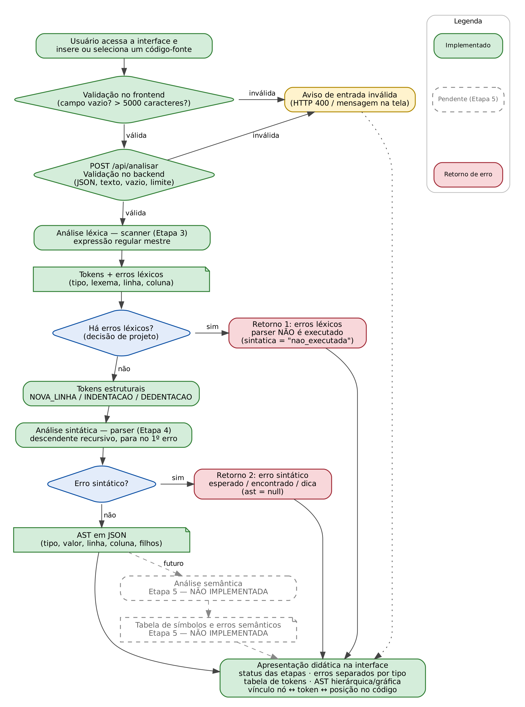
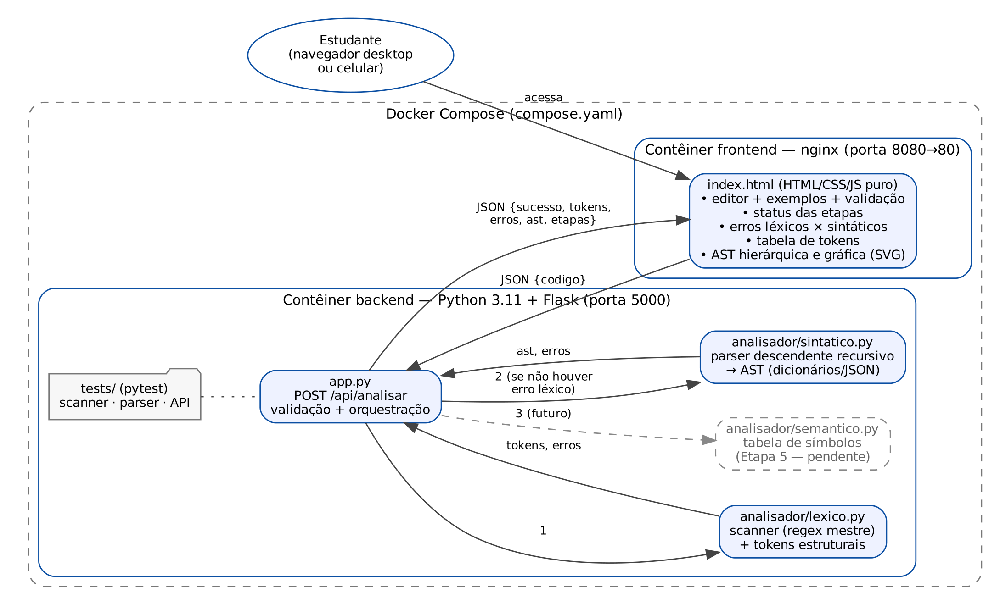

# Fluxograma e arquitetura — Etapa 4

## Fluxograma do sistema

Fonte editável: [`fluxograma.dot`](fluxograma.dot) (Graphviz). Para regenerar:
`dot -Tpng -Gdpi=200 fluxograma.dot -o fluxograma.png`.

- **Verde:** implementado (entrada, validação no frontend e no backend, scanner, tokens estruturais, parser, AST e
  apresentação).
- **Tracejado cinza:** pendente — análise semântica e tabela de símbolos (Etapa 5).
- **Vermelho:** pontos de retorno de erro ao usuário. Erros léxicos e sintáticos são devolvidos separadamente.
- **Decisão de projeto:** se houver erro léxico, o parser **não** é executado (`etapas.sintatica = "nao_executada"`).

## Arquitetura

Fonte editável: [`arquitetura.dot`](arquitetura.dot).

| Módulo | Responsabilidade |
|---|---|
| `frontend/index.html` | Entrada e exemplos, validação, status das etapas, erros por tipo, tabela de tokens, AST hierárquica e gráfica, vínculo nó ↔ token ↔ código |
| `backend/app.py` | Rota `POST /api/analisar`, validação da entrada, orquestração do pipeline |
| `backend/analisador/lexico.py` | Scanner (expressão regular mestre) e geração dos tokens estruturais de indentação |
| `backend/analisador/sintatico.py` | Parser descendente recursivo, construção da AST, mensagens de erro sintático |
| `backend/tests/` | Testes automatizados (pytest) do scanner, do parser e da API |
| `compose.yaml` | Orquestra os contêineres `frontend` (nginx, 8080) e `backend` (Flask, 5000) |
